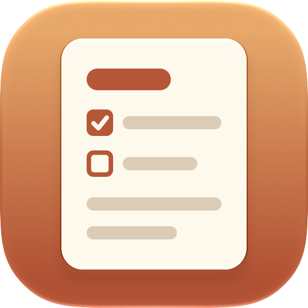

# Heracles



A local-first, hierarchical notebook for macOS: pages in notebooks, a block editor, split panes and kanban boards. Everything is stored on your Mac in one SQLite database.

Heracles is a native Mac app, written in Swift over a Rust core.

## Status and download

The native app is a preview. The latest build is on the [releases page](https://github.com/tacticalbadger/Heracles/releases): a universal app for macOS 14 or later. Download the `.dmg`, open it, and drag Heracles onto the Applications folder beside it.

- The build is signed with a Developer ID certificate and notarized by Apple, so it opens like any other downloaded app.
- From 0.4.0 on it updates itself. It looks for a new version once a day and from **Heracles ▸ Check for Updates…**, shows what changed, and installs it when you agree. **Check for Updates Automatically** turns the daily look off. Keep the app in Applications for this to work.
- Version 0.3.3 and earlier cannot update themselves. Install a current version by hand once, and later ones arrive in the app.
- Nobody has used it day to day yet. It passes its automated tests, which cannot move a mouse.
- If the original Heracles app (version 0.1) left a library on your Mac, it is copied into the new database the first time the app starts. See [Data storage](#data-storage).

What is built, what is missing and what has not been checked is recorded in [`docs/status.md`](./docs/status.md).

## Features

- **Notebooks, sections and pages** in a sidebar, nested as deep as you like, with favorites, archive and trash. Trashing, restoring and deleting apply to a page and everything under it.
- **Panes and tabs.** Split a window right or down, drag the dividers, and drag tabs between panes. Each window remembers its layout, and any number of windows can be open on the same library (**File ▸ New Window**).
- **Block editor.** Headings, lists, task lists, quotes, callouts, toggles, code blocks, images and column layouts. Each block's text is a system text view, so typing, selection, spelling and dictation work as they do across the Mac.
- **Markdown as you type**, a slash menu of blocks, and a Format menu with the usual shortcuts.
- **Blocks you can pick up.** Each block has a handle to drag it, make columns with it, duplicate it, turn it into another kind of block, or copy a link to it. Whole blocks can be selected, copied and moved together.
- **Kanban boards.** A todo list is a board with your own columns, which you can rename and reorder. A card opens as a task in a window of its own, so the board stays in reach and several tasks can be open at once. Tasks carry notes, priority, a due date, a deadline, labels, a location, reminders, comments and subtasks nested to any depth.
- **Reminders** arrive as system notifications, whether or not the app is open.
- **Search** across every note's title and text.
- **Quick Open** (⌘K) to jump to a note by name.
- **Import and export.** Import Markdown and HTML files as pages, with their pictures. Export a note as Markdown with its pictures beside it.
- **Links between notes.** `heracles://` links open a note, or scroll to one block of it.

## How it is built

| Layer | Choice |
|---|---|
| Interface | Swift 6, SwiftUI and AppKit |
| Core | Rust (`heracles-core`): storage, documents, search, import and export |
| Bridge | UniFFI, which generates the Swift bindings to the core |
| Storage | SQLite with full-text search, bundled into the core |
| Editor | Native: a document model in Swift, shown as one system text view (TextKit 2) per block |
| Build | Cargo and Swift Package Manager, run by the scripts in `macos/` |

The core owns the data. Every window reads from it and subscribes to its change feed, which is what keeps two windows showing the same note in step. Documents are stored as blocks in JSON, and pictures are stored once each, outside the notes that use them.

## Building

You need Rust (through [rustup](https://rustup.rs), with the `aarch64-apple-darwin` and `x86_64-apple-darwin` targets) and Xcode.

```bash
macos/build-app.sh              # universal build → build/Heracles.app
macos/build-app.sh --host-only  # this Mac's processor only, faster
```

To run the tests:

```bash
cargo test                           # the core
swift test --package-path macos      # the bindings, the app's model and the editor
build/Heracles.app/Contents/MacOS/Heracles --self-test
macos/window-check.sh                # the running app's menus and windows
```

[`BUILDING.md`](./BUILDING.md) has the details, including how to sign and publish a release.

## Project structure

```
core/                      heracles-core: the app's data layer (Rust)
├── src/doc/               Block document model, HTML and Markdown conversion
├── src/store/             SQLite schema, notes, boards, search, image store
├── src/transfer.rs        Import and export of files
├── src/legacy.rs          One-time import of the original app's library
├── src/changes.rs         Change feed that keeps every window current
└── tests/                 Behaviour tests, one file per area
macos/                     The Mac app (Swift)
├── build-app.sh           Builds build/Heracles.app
├── build-core.sh          Builds the core and its Swift bindings
├── sign-app.sh            Signs the app and the updater inside it
├── release.sh             Signs and notarizes a build, makes its disk image and its update feed
├── publish.sh             Publishes a release on GitHub, feed included
├── update-config.sh       Where updates come from and the key they are checked against
├── update-rehearsal.sh    Rehearses a whole update on this Mac
├── check-build-number.sh  Stops a release nobody would be offered
├── verify-update.sh       Checks an update's signature against a key
├── test-release-scripts.sh  Checks of the two scripts above
├── window-check.sh        Checks the running app's menus and windows
├── make-icon.sh           Compiles the app icon after a change to it
├── Icon/                  The app icon: its source and its compiled forms
├── Sources/HeraclesCore/  Generated bindings to the core
├── Sources/HeraclesApp/   Model, sidebar, panes, board
│   └── Editor/            The block editor: document model, text views, page
└── Tests/                 Binding, app model and editor tests
tools/bindgen/             UniFFI's Swift bindings generator, version-pinned
```

## Data storage

The app keeps everything in `~/Library/Application Support/Heracles/`:

| Path | Holds |
|---|---|
| `heracles.db` | Notes, documents, boards and the search index, in SQLite |
| `images/` | Pictures, one file each, named by their content |
| `backups/` | The copy made of the original app's library before it was imported |

The original Heracles app (version 0.1) kept its library in the same folder, in `heracles.sqlite`. The first time the app starts and finds that file, it backs it up, reads the backup, and copies the library into `heracles.db`. The old file is never changed.

To try the app on a different folder, start it with `HERACLES_DATA_DIR` set:

```bash
HERACLES_DATA_DIR=~/heracles-trial build/Heracles.app/Contents/MacOS/Heracles
```

## Documentation

- [`CHANGELOG.md`](./CHANGELOG.md) — notable changes per release
- [`BUILDING.md`](./BUILDING.md) — build, signing, release and update guide
- [`docs/status.md`](./docs/status.md) — what is built, the choices behind it, what is missing and what has not been checked

## License

Heracles is proprietary software, not open source. Copyright © 2026 tacticalbadger. All rights reserved.

The source is public so that it can be read. You may download and run the released app. Copying, changing or redistributing the code or the app needs written permission. The terms are in [`LICENSE`](./LICENSE).
